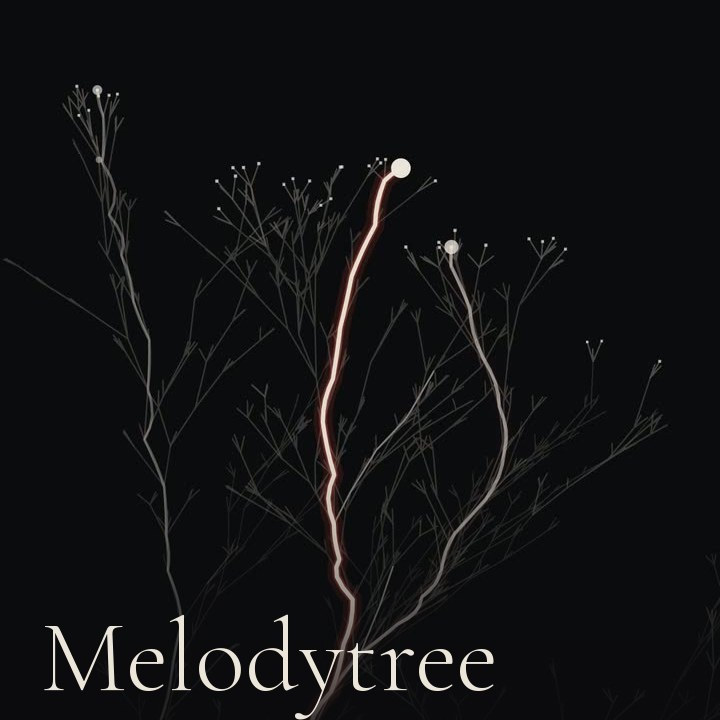

# Melodytree

**English** · [Português](README.pt-BR.md) · [Live](https://www.sapiensinteticos.com/melodytree)

Drop a song and a search tree grows with it. Three bolts of light travel the
branches, one listening to the bass, one to the mids, one to the highs. When the
track ends, the path the music chose becomes its signature.

[](https://www.sapiensinteticos.com/melodytree)

Everything runs in the browser. The song never leaves the device: no upload, no
server, no account.

## How it works

It is a beam search, the algorithm that keeps the best few candidates at every
step and drops the rest, drawn as a tree, with the music deciding what "best"
means.

- **Three voices, three bolts.** Bass, mids and highs each drive one bolt on its
  own branch, and each bolt has a guaranteed place in the beam. Without that the
  beam collapses into one branch and the three voices end up glued together.
- **The camera reads the song's shape.** Energy of the last 0.8 s against the
  last 8 s. It rises (the chorus): the beam opens and the camera pulls back. It
  falls (the verse): everything closes in. It nearly vanishes with the music
  still playing (the break): the search holds and the camera breathes.
- **Silence is the brake.** Everything that moves is multiplied by how present
  the sound is. Pause the song and the tree stops where it is. Nothing restarts
  from zero.
- **The signature.** The main bolt's path is recorded, and at the end the camera
  pulls back to show the whole track: a 4K PNG, portrait or landscape. You can
  record the video too.
- **Touch it.** A click is a drop falling into the sea: a small aura, three
  flattened rings opening in perspective, and the branches light up as the first
  ring crosses them. It also plays a note in the song's key. A chromagram of the
  last few seconds, matched against the Krumhansl key profiles, picks a
  pentatonic scale that will not clash with the track. Higher on the screen is
  higher in pitch, left and right is stereo, and dragging strums.

## Run it

ES modules need a server, so a double click won't do:

```bash
git clone https://github.com/inhabitants/melodytree
cd melodytree
npx serve .
```

Open the address it prints, then drop a song or let it listen through the
microphone.

## Your own playlist

Put a `musicas/lista.json` next to `index.html` and the start screen lists up to
five of its tracks (three in the embed), picked at random on every visit:

```json
{
  "faixas": [
    { "titulo": "Song title", "arquivo": "https://example.com/song.mp3", "lingua": "en" }
  ]
}
```

Tracks on another domain must send CORS headers, or the analyser hears silence.
`lingua` is optional: when the titles come in several languages, the start
screen shows one of each first.

## Embed it

Inside an iframe the page turns into a compact card by itself: the tracks come
first, the long intro goes, and saving and recording move behind a "full version"
link, because a download from inside an iframe can be blocked. `?de=x` forces the
card outside an iframe, for testing.

```html
<iframe src="https://inhabitants.github.io/melodytree/" width="480" height="480" allow="autoplay; fullscreen"></iframe>
```

On X the page is a player card: paste its link in a post and the tree plays
inside the post. Hosting your own copy, point the `og:image` and `twitter:*` tags
in `index.html` to your address.

## Files

- `index.html`: the page and its styles.
- `app.js`: the start screen, the bar, saving, recording, and the touch (which
  note, and the soft mallet synth that plays it).
- `lib/arvore-motor.js`: the engine. No DOM and no Web Audio: it takes the sound
  state every step and paints on any canvas, the screen or a 4K one.
- `lib/escuta.js`: the listener. Turns the playing audio into that sound state
  (bands, onsets, beats, pitch, presence).

The code speaks Portuguese; the README speaks English.
`criarArvore({ marca: ["Bold", ".light"] })` stamps a name in the corner of the
signature; without it the corner stays empty.

## Status

Published, not maintained. It works and it will stay as it is. Issues may go
unanswered and pull requests may wait. Fork freely.

## License

Code under MIT. The fonts are Cormorant Garamond under the SIL Open Font License
(`fonts/OFL.txt`), with the circumflex redrawn to sit on the letter.

Made at [Sapiens Sintéticos](https://www.sapiensinteticos.com/melodytree), where
it plays Helen Ailith's music.
