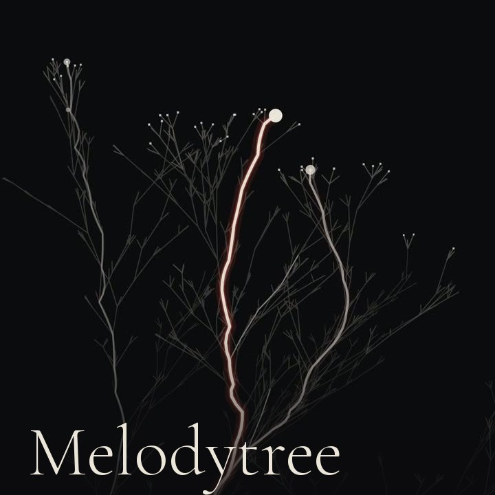

# Melodytree

[English](README.md) · **Português** · [No ar](https://www.sapiensinteticos.com/melodytree?lang=pt)

Solta uma música e uma árvore de busca cresce com ela. Três raios de luz andam
pelos galhos, um ouvindo o grave, um o médio, um o agudo. Quando a faixa acaba,
o caminho que a música escolheu vira a assinatura dela.

[](https://www.sapiensinteticos.com/melodytree?lang=pt)

Tudo roda no navegador. A música não sai do aparelho: nada sobe, não tem
servidor, não pede conta.

## Como funciona

É uma busca em feixe (beam search), o algoritmo que guarda os melhores
candidatos a cada passo e larga o resto, desenhada como árvore, e quem decide o
que é "melhor" é a música.

- **Três vozes, três raios.** Grave, médio e agudo levam um raio cada, num galho
  próprio, e cada raio tem lugar garantido no feixe. Sem isso o feixe colapsa num
  galho só e as três vozes acabam encostadas.
- **A câmera lê a forma da música.** A energia dos últimos 0,8 s contra a dos
  últimos 8 s. Subiu (refrão): o feixe abre e a câmera se afasta. Desceu (verso):
  tudo fecha. Quase sumiu com a música tocando (a quebra): a busca segura e a
  câmera respira.
- **O silêncio é o freio.** Tudo que anda é multiplicado por quanto som tem.
  Pausa a música e a árvore para onde está. Nada recomeça do zero.
- **A assinatura.** O caminho do raio principal fica gravado, e no fim a câmera
  recua pra mostrar a faixa inteira: um PNG 4K, em pé ou deitado. Dá pra gravar
  o vídeo também.
- **Toca nela.** O clique é uma gota caindo no mar: uma aura pequena, três anéis
  achatados abrindo em perspectiva, e os galhos acendem quando o primeiro anel
  passa por eles. E soa uma nota no tom da música. Um cromagrama dos últimos
  segundos, comparado com os perfis de tonalidade de Krumhansl, escolhe uma
  pentatônica que não briga com a faixa. Mais alto na tela é mais agudo, o lado
  vira estéreo, e arrastar dedilha.

## Rodar

Módulo ES precisa de servidor, então duplo clique não serve:

```bash
git clone https://github.com/inhabitants/melodytree
cd melodytree
npx serve .
```

Abre o endereço que ele mostra, solta uma música ou deixa ouvir pelo microfone.

## A sua playlist

Põe um `musicas/lista.json` do lado do `index.html` e a entrada lista até cinco
faixas dele (três no embed), sorteadas a cada visita:

```json
{
  "faixas": [
    { "titulo": "Nome da faixa", "arquivo": "https://exemplo.com/faixa.mp3", "lingua": "pt" }
  ]
}
```

Faixa em outro domínio precisa mandar CORS, senão o analisador ouve silêncio.
`lingua` é opcional: quando os títulos vêm em mais de uma língua, a entrada
mostra uma de cada primeiro.

## Embutir

Dentro de iframe a página vira cartão sozinha: as faixas vêm primeiro, o encarte
sai, e salvar e gravar passam pra um link "versão completa", porque baixar
arquivo de dentro do iframe pode ser barrado. `?de=x` força o cartão fora do
iframe, pra testar.

```html
<iframe src="https://inhabitants.github.io/melodytree/" width="480" height="480" allow="autoplay; fullscreen"></iframe>
```

No X a página é player card: cola o link num post e a árvore toca dentro dele.
Hospedando a sua cópia, troca as tags `og:image` e `twitter:*` do `index.html`
pro seu endereço.

## Arquivos

- `index.html`: a página e o estilo.
- `app.js`: a entrada, a barra, salvar, gravar e o toque (qual nota, e o timbre
  de baqueta macia que toca ela).
- `lib/arvore-motor.js`: o motor. Sem DOM e sem Web Audio: recebe o estado do som
  a cada passo e pinta em qualquer canvas, o da tela ou um de 4K.
- `lib/escuta.js`: a escuta. Transforma o áudio que toca nesse estado (bandas,
  ataques, batidas, altura, presença).

`criarArvore({ marca: ["Forte", ".leve"] })` carimba um nome no canto da
assinatura; sem isso o canto fica vazio.

## Estado

Publicado, não mantido. Funciona e vai ficar como está. Issue pode ficar sem
resposta e pull request pode esperar. Fork à vontade.

## Licença

Código em MIT. As fontes são a Cormorant Garamond na SIL Open Font License
(`fonts/OFL.txt`), com o circunflexo redesenhado pra assentar na letra.

Feito na [Sapiens Sintéticos](https://www.sapiensinteticos.com/melodytree?lang=pt),
onde toca a música da Helen Ailith.
